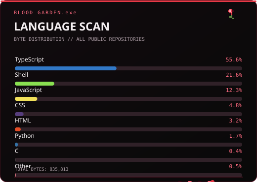
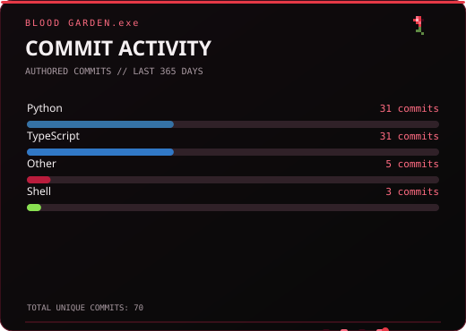

# Welcome little arthropod!
### ❤️ | I'm Adria! Full-cycle web developer! Building applications from development to deploy 🌹
--- 

  

## 💻 - Tecnologies
### ❤️ | Here you can see some of the technologies i use on my workflows ;) 

## 03. GITHUB MONITORING

  
  &nbsp;&nbsp;
  

---

## 02. THE TECH GARDEN

### ◈ Interface & Experience

### ◈ Data & Backend

### ◈ Infrastructure & Systems

---

## 04. DIGITAL EXPERIMENTS

*Selected repositories, experiments and projects.*

Explore my repositories:

---

### CONNECTION ESTABLISHED

*Built with maestry.*

`BLOOD GARDEN.exe // END OF TRANSMISSION`

